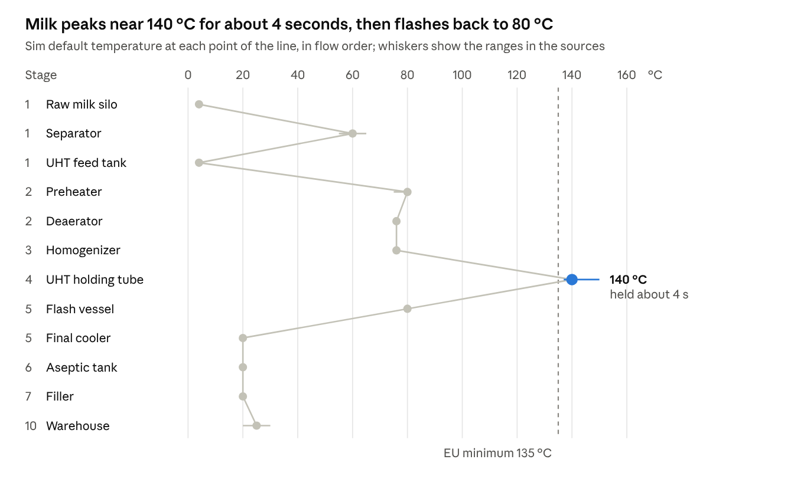

[Index](README.md) · Part 2 of 11 · [Review](REVIEW.md)

# The UHT line at a glance

The 10 stages form one line with a single hand-off: at the aseptic tank, flowing milk becomes packs you can count, track and hold.

*process flow · 10 stages, one hand-off*

UHT is the critical control point: when the sterilizing effect drops, milk is diverted before it reaches the tank.

**3D preview:** [UHT Milk Plant Preview](https://claude.ai/artifact/8iJvem1sGHtitmtJDxUpY6) runs this flow in the browser with grey-box models, example data, speed controls and three fault scenarios. (Local copy: [uht-plant-preview.html](../uht-plant-preview.html).)

*sim defaults and source ranges · Tetra Pak handbook, Regulation 853/2004, GEA*

The sim uses the dots as set points and colours each pipe from them; the separator step sits in the upstream milk-treatment line, before the milk is cooled and stored for UHT.

## Chart values as text

*Transcribed from the chart above. The values match the stage panels in the preview.*

| Stage | Point on the line | Sim default | Range in the sources |
|---|---|---|---|
| 1 | Raw milk silo | 4 °C | — |
| 1 | Separator | 60 °C | 55–65 °C |
| 1 | UHT feed tank | 4 °C | — |
| 2 | Preheater | 80 °C | 75–80 °C |
| 2 | Deaerator | 76 °C | — |
| 3 | Homogenizer | 76 °C | — |
| 4 | UHT holding tube | 140 °C, held about 4 s | 140–150 °C; EU minimum 135 °C |
| 5 | Flash vessel | 80 °C | — |
| 5 | Final cooler | 20 °C | — |
| 6 | Aseptic tank | 20 °C | — |
| 7 | Filler | 20 °C | — |
| 10 | Warehouse | 25 °C | 20–30 °C |

> **Review note:** the homogenizer row shows 76 °C, but Stage 3 also simulates a temperature rise of about 1 °C per 40 bar. See [R7](REVIEW.md#r7-homogenizer-outlet).

---

← [1. Goal & scope](01-goal-and-scope.md) · [3. Stage research 1–5](03-stages-1-5-liquid-line.md) →
