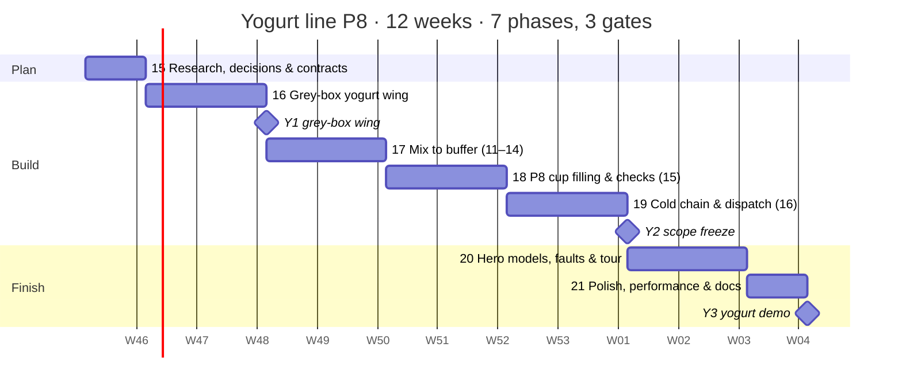

[Index](README.md) · Part 9 of 11 · [Review](REVIEW.md)

# Development roadmap

Build in six phases over 12 weeks: grey-box the whole plant first, make the liquid line work, then the packaging and logistics, and only then spend time on detailed models and polish.

*12-week plan · 6 phases, 3 review gates*

Gate 2 is the safety net: if the run from silo to truck does not work by week 9, cut Could items instead of stretching the schedule.

## Phases and gates as text

*Transcribed from the chart above.*

| Phase | Weeks | Ends with gate |
|---|---|---|
| Setup | 1 | — |
| Grey-box plant | 2–3 | G1 · grey-box plant |
| Liquid line (1–6) | 4–6 | — |
| Packs to trucks (7–10) | 7–9 | G2 · scope freeze |
| Detail & scenarios | 10–11 | — |
| Polish & present | 12 | G3 · final demo |

## Deliverables to tick off

- [x] Week 1: Vite + three.js project runs; `plant.json` holds the default settings
- [ ] Week 3 (gate 1): grey-box plant with all seven zones, pipes and camera fly-to
- [ ] Week 6: stages 1–6 live (levels, temperatures, F0 and B\*, divert); formula tests pass
- [ ] Week 9 (gate 2): stages 7–10 live (packs, pallets, quarantine, warehouse, trucks); scope frozen
- [ ] Week 11: hero models, six fault scenarios, guided tour
- [ ] Week 12 (gate 3): 60 fps check, demo video, report and presentation

If the term runs past 12 weeks, the stretch list is: animated CIP cleaning, a steam and energy model, a switch between direct and indirect UHT, and a mobile layout. The first two are built, as phases 7 and 8 ([status](agent-plan/phase-6-polish-and-present.md#afterwards)); the switch and the mobile layout are not.

After the term, the developer's own factory: phase 9 shows its three UHT plants and six lines on a live board fed by Let Report ([phase 9](agent-plan/phase-9-factory-board.md), [D19](DECISIONS.md#d19-the-factory-board)). Phase 10 puts the three UHT trains on a floor in 3D beside the board, each with its UHT, aseptic tank and fillers, driven from the same data ([phase 10](agent-plan/phase-10-factory-floor.md), [D20](DECISIONS.md#d20-the-factory-floor-in-3d)). Phase 11 gives the simulation and Let Report one modern look, a dark control room with the light theme kept ([phase 11](agent-plan/phase-11-control-room.md), [D21](DECISIONS.md#d21-the-control-room-look)). Phase 12 makes the end of the teaching line move like the real machines: the palletizer robot picks and stacks trays, the stretch wrapper winds film, forklifts put pallets away and load trucks, and trucks back up to the dock and leave ([phase 12](agent-plan/phase-12-lifelike-motion.md), [D22](DECISIONS.md#d22-lifelike-motion-at-the-end-of-the-line)). Phase 13 details the CIP station: its chemicals and their strength, the conductivity on its return and where the return goes, and the caustic, acid and water the cleans use ([phase 13](agent-plan/phase-13-cip-station.md), [D23](DECISIONS.md#d23-the-cip-stations-chemicals-and-returns)). Phase 14 draws and moves the forklifts as a real electric counterbalance truck: an operator, a mast that tilts back with its load, steering rear wheels, the datasheet's lift speeds and the blue safety spot ([phase 14](agent-plan/phase-14-forklift-detail.md), [D24](DECISIONS.md#d24-the-forklifts-in-detail)).

The [agent plan](agent-plan/README.md) breaks each phase down into tasks for seven agents working in parallel, with hand-offs and an exit checklist per phase.

> **Decided in week 1:** the batch definition, the missing defaults and the truck load are in the [decision log](DECISIONS.md), waiting for the developer's approval.

## The yogurt line (phases 15–21)

The plant gains a second product: stirred and set yogurt in 125 g cups on Line P8, in a new wing north of the milk row ([plan 12](12-yogurt-line.md), [SOP](yogurt-sop-p8.md), [D25](DECISIONS.md#d25-the-yogurt-line-line-p8), [D26](DECISIONS.md#d26-the-yogurt-lines-defaults)). It is built the way the first ten stages were:
- research and numbers first;
- then a grey-box wing;
- then the liquid side, the cups and the cold chain;
- details and faults only after the scope freeze.

It takes seven phases over 12 weeks, with three gates.

| Phase | Weeks | Critical path | Ends with | Detail |
|---|---|---|---|---|
| 15. Research, decisions & contracts | 1 | process, lead | D25–D26 approved, H122–H125, schema 10, contracts v8, mock yogurt snapshot | [Phase 15](agent-plan/phase-15-yogurt-research-and-contracts.md) |
| 16. Grey-box yogurt wing | 2–3 | scene, ui | **Y1** · the wing in grey boxes, the rail grouped by line, panels 11–16 from the mock | [Phase 16](agent-plan/phase-16-yogurt-grey-box.md) |
| 17. Mix to buffer (stages 11–14) | 4–5 | sim | Heat treatment and divert, denaturation, pH curves, set/stirred routing live | [Phase 17](agent-plan/phase-17-yogurt-liquid-line.md) |
| 18. Line P8 cup filling & checks (stage 15) | 6–7 | sim, scene | Cups filled, sealed, coded, weighed and inspected; HEPA, SIP and seal-test interlocks | [Phase 18](agent-plan/phase-18-p8-cup-filler.md) |
| 19. Cold chain & dispatch (stage 16) | 8–9 | sim, scene | **Y2** · scope freeze: milk to cup to reefer truck, both routes | [Phase 19](agent-plan/phase-19-yogurt-cold-chain.md) |
| 20. Hero models, faults & tour | 10–11 | assets, sim, ui | P8 and fermentation-tank heroes, five yogurt faults, the yogurt tour | [Phase 20](agent-plan/phase-20-yogurt-detail-and-scenarios.md) |
| 21. Polish, performance & docs | 12 | qa, lead | **Y3** · 60 fps with both lines; report, demo and slides updated | [Phase 21](agent-plan/phase-21-yogurt-polish.md) |

Gate Y2 is the safety net here too. If the run from silo to reefer truck does not work for both routes by week 9, cut Could items rather than stretch the schedule.

The Could list, in order:
1. fruit dosing (keep plain only);
2. the set route's warm room (keep stirred only);
3. the vision station;
4. the factory board's yogurt lines.

### Yogurt deliverables to tick off

- [ ] Week 1: D25 and D26 approved; `plant.json` schema 10; contracts v8; stages 11–16 in `stages.json`; the mock yogurt snapshot drives the UI.
- [ ] Week 3 (gate Y1): the wing's four zones in grey boxes, with pipes, camera stops, the grouped stage rail and panels 11–16.
- [ ] Week 5: stages 11–14 live (fat and SNF, divert at 85 °C, denaturation, three tanks' pH, cooling, buffer); tests against H122–H125.
- [ ] Week 7: stage 15 live (cups, seal window, checkweigher, metal and vision rejects, seal tests, HEPA, SIP); tests against H126–H129.
- [ ] Week 9 (gate Y2): stage 16 live (trays, pallets, warm room, blast chiller, cold-room hold, reefer trucks); a 7-day run conserves cups; scope frozen.
- [ ] Week 11: P8 and fermentation-tank hero models, five yogurt faults, the yogurt tour, "About this model".
- [ ] Week 12 (gate Y3): the 60 fps check with both lines; the report, demo script and slides updated.

---

← [8. User interface](08-user-interface.md) · [10. Risks & simplifications](10-risks-and-simplifications.md) →
