[Index](README.md) · Part 12 · [Review](REVIEW.md)

# The yogurt line (Line P8)

Add a second product to the teaching plant: yogurt in 125 g cups, made on Line P8 in a new wing of the same plant. The line follows the developer's [SOP](yogurt-sop-p8.md) and makes both kinds it describes: **stirred** yogurt, fermented in bulk tanks, and **set** yogurt, fermented in the cup in a warm room. It runs as six new stages, 11–16, on the same clock as the UHT line. It shares the tanker reception, the CIP chemistry, the steam and the time controls, and it has a tour of its own.

The UHT line's ten stages, its numbers and its tests do not change. The decisions are [D25](DECISIONS.md#d25-the-yogurt-line-line-p8) (scope, stages, layout) and [D26](DECISIONS.md#d26-the-yogurt-lines-defaults) (the numbers), and the schedule is in the [roadmap](09-development-roadmap.md#the-yogurt-line-phases-1521).

## The line at a glance

```mermaid
flowchart LR
  R[Raw milk ≤ 4 °C<br/>own silo] --> S11[11 Mix preparation<br/>fat, SNF, powder, stabilizer]
  S11 --> S12[12 Deaeration, homogenization<br/>& heat treatment 92 °C × 5 min]
  S12 --> S13[13 Cool to 43 °C<br/>culture & fermentation]
  S13 -- stirred: bulk tanks to pH 4.55 --> S14[14 Smoothing, cooling to 18 °C<br/>P8 buffer, fruit dosing]
  S13 -- set: inoculated warm mix --> S14
  S14 --> S15[15 P8 cup filler<br/>fill, seal, code, inspect]
  S15 --> S16[16 Trays, pallets & cold chain]
  S16 -- set: warm room to pH ≤ 4.60 --> C[Blast chiller ≤ 4 °C]
  S16 -- stirred --> C
  C --> CR[Cold room 2–4 °C<br/>24–48 h hold] --> T[Reefer truck]
```

The heat treatment (stage 12) is the yogurt line's critical control point. The P8 filler's hygiene (HEPA overpressure, SIP, seal integrity) is its second line of defence.

## Stage research 11–16

### 11. Mix preparation

The yogurt mix is made from standardized milk with its fat set and its solids-not-fat (SNF) raised.

- **Real process ([SOP](yogurt-sop-p8.md#part-1-upstream-processing-flow-milk-preparation--fermentation) 1–2):**
  - Raw milk arrives at ≤ 4 °C and is tested for acidity, fat, total solids, antibiotics and alcohol stability.
  - It is clarified and separated, and the fat and SNF are standardized.
  - Milk powder and stabilizer are dosed by recipe.
  - The handbook raises yogurt's dry matter to about 14–16% with skim-milk powder or by evaporation ([Fermented milk products](https://dairyprocessinghandbook.tetrapak.com/chapter/fermented-milk-products)).
- **In the plant:**
  - The wing has its own raw-milk silo, filled from the same tanker bay. That way the UHT line's silo levels, which phases 3–8 tested, stay as they are.
  - Skim from the UHT line's separator is not used; the wing has its own small standardization skid.
- **3D:**
  - the yogurt silo;
  - a powder hopper with a big-bag station and a high-shear mixer (a powder funnel on a pump);
  - a stabilizer dosing skid;
  - the mix tank with an agitator.
- **Simulate:**
  - fat and SNF by mass balance;
  - the powder dosed per tonne of mix;
  - the silo and mix-tank levels;
  - the recipe of the batch being made.

### 12. Deaeration, homogenization & heat treatment

- **Real process (SOP 3–4):**
  - The mix is deaerated under vacuum.
  - It is homogenized at 150–200 bar and 65–70 °C, to break the fat globules and reduce syneresis.
  - It is then heated to 85–95 °C for 3–5 min. The heat denatures the whey proteins (mainly β-lactoglobulin), which then build into the gel and hold water, and it kills the vegetative microorganisms.
  - The handbook gives 90–95 °C for about 5 min, with heat recovered in the plate heat exchanger.
- **3D:**
  - a plate heat exchanger (regeneration, heating, cooling sections);
  - a deaerator;
  - a small homogenizer, reusing the UHT line's model at a smaller scale;
  - a holding cell drawn as a serpentine tube;
  - a divert valve.
- **Simulate:**
  - the outlet temperatures and the holding time;
  - the whey-protein denaturation %, from the kinetics of Dannenberg & Kessler (1988), settled in phase 15 (H124);
  - the divert, with its own reprocess tank and log entries.
  - **Divert rule (CCP):** the mix is diverted below 85 °C at the holding-cell outlet, or if the hold is shorter than 3 min.

### 13. Inoculation & fermentation

- **Real process (SOP 5–6):**
  - The mix is cooled in-line to 41–43 °C.
  - Starter culture (*L. bulgaricus* and *S. thermophilus*) is injected.
  - Stirred yogurt ferments in insulated bulk tanks until pH 4.50–4.65.
  - Set yogurt goes straight to the P8 buffer, still warm, and ferments in the cup.
- **3D:**
  - the culture dosing pump;
  - three insulated fermentation tanks with slow agitators, each with a pH probe readout on its label.
- **Simulate:**
  - the pH curve of each tank, falling from 6.6 to the end pH. It has a lag phase and then an S-shaped drop, and the rate depends on the temperature (fastest at 43 °C).
  - The titratable acidity follows the pH.
  - A tank's cycle: fill, ferment, hold at the end pH, empty, CIP.
  - Only one tank is filled at a time, and the filler is fed from one tank at a time.

### 14. Smoothing, cooling & the P8 buffer

- **Real process (SOP 6B, P8 step 1):**
  - The coagulum is smoothed gently, at low shear so the curd does not thin.
  - It is cooled to 15–20 °C in a plate heat exchanger.
  - It is pumped to the P8 buffer tank and fed to the filler manifold under controlled positive pressure.
  - Fruit or flavour preparation is dosed in-line, in step with the product flow.
- **3D:**
  - a smoothing valve or filter;
  - the plate cooler;
  - the P8 buffer tank;
  - the fruit-preparation tank with its dosing pump, which turns only while a fruit recipe runs.
- **Simulate:**
  - the cooler outlet temperature;
  - the buffer level, between the tank draw and the filler draw;
  - the fruit dose rate (% of the flow).
  - **Set yogurt:** it skips the smoothing and the cooler. The buffer holds warm, inoculated mix at 43 °C, and the time it may wait there is limited, because it starts to set.

### 15. Line P8: cup filling & in-line checks

P8 is a linear cup filler under a HEPA hood ([SOP Part 2](yogurt-sop-p8.md#part-2-packaging--filling-flow-bench--machine-p8)).

| Station | What it does | Simulated as |
|---|---|---|
| De-nester | Suction cups drop cups from vertical magazines into the carrier pockets | Magazine level; a refill event |
| Ionized air + vacuum | Neutralizes static, loosens and extracts debris | On/off with the line |
| UV-C tunnel | Disinfects the cups' inner surfaces | Lamp on; a dose readout (sim) |
| Piston fillers | Multi-head volumetric pistons and low-shear anti-drip nozzles | Fill weight per cup (normal around the target) |
| Foil lidding + sealing | Pre-cut foils centred, heat-sealed at 180–220 °C, 0.8–1.2 s, 4–6 bar | The seal temperature, time and pressure; a leak chance that rises outside the window |
| Coder | Date of manufacture, expiry, batch, "P8" | The code printed on each cup's token label |
| Checkweigher | Rejects under- and over-fills | Rejects counted against the limits |
| Metal detector / X-ray | Ferrous, non-ferrous, stainless | A rare reject (sim rate) |
| Vision | Lid alignment, print legibility | A rare reject (sim rate) |

- **Hygiene limits (SOP Part 3):**
  - The filler may start only after a logged CIP and an SIP at ≥ 121 °C for 20 min, and with an ATP swab below 10 RLU.
  - The HEPA cabin must hold at least +15 Pa against the packaging hall; below that the filler stops.
  - Every 2 operating hours, 5 cups go to the dye-penetration and vacuum-leak tests. A failed test holds every cup made since the last test that passed.
- **3D:**
  - the P8 hero model: cup magazines, an indexing carrier chain, the UV tunnel, a piston manifold, foil magazines, sealing heads, all under a clear HEPA hood;
  - the in-line check gates: checkweigher, metal detector, vision;
  - a reject bin.

### 16. Trays, pallets & the cold chain

- **Real process (SOP P8 step 7):**
  - A robot packs the cups into trays, which are palletized and stretch-wrapped.
  - **Set yogurt** goes to the 41–43 °C incubation room until its pH reaches ≤ 4.60, then to the blast chilling tunnel.
  - **Stirred yogurt** goes straight to the blast chiller, down to ≤ 4 °C.
  - Both then hold in the cold room at 2–4 °C for 24–48 h while the gel stabilizes, before release and dispatch.
- **3D:**
  - a pick-and-place tray packer;
  - a palletizer and stretch wrapper, which reuse phase 12's robot and wrapper;
  - an incubation room with insulated panels and a warm-glow lamp;
  - a blast chilling tunnel with a frost tint;
  - a cold room with racks;
  - a reefer dock where refrigerated trucks back up. This reuses phase 12's truck moves, with a refrigeration unit added to the trailer.
- **Simulate:**
  - each pallet's temperature, pH (for set yogurt), hold clock and release;
  - the cold-room temperature and the positions used;
  - reefer departures, using the same release-and-load logic as stages 9–10.

## Product plan

The line runs one product at a time. The default day ([D26](DECISIONS.md#d26-the-yogurt-lines-defaults)):

| Shift | Product | Route |
|---|---|---|
| 06:00–14:00 | Plain stirred yogurt | Bulk fermentation |
| 14:00–22:00 | Strawberry stirred yogurt (fruit dosed at 15%) | Bulk fermentation |
| 22:00–06:00 | Plain set yogurt | Cup fermentation in the warm room |

There is a rinse between the two stirred products and a CIP and SIP before the set yogurt. A new command lets the viewer change the next shift's product.

## How it joins the existing plant

| Thing | Shared or new |
|---|---|
| Clock, speeds, "Next event", log, scenario log | Shared |
| Tanker bay | Shared; the wing has its own silo |
| CIP chemistry and step model (phase 13, `src/sim/liquid/cleaningChemistry.ts`) | Reused by the wing's own CIP circuit, with the SOP's ranges |
| Steam and energy (phase 8) | Shared boiler; the heat treatment's steam is added to the KPI, and is shown on its own |
| Palletizer robot, stretch wrapper, forklifts, truck moves (phases 12, 14) | Reused as new instances in the wing |
| Stage rail, info panel, KPI strip, tour | Extended: the rail is grouped "UHT milk" / "Yogurt P8", and a second tour covers stages 11–16 |
| Factory board (phases 9–10) | Unchanged; a Could item shows Let Report's yogurt lines later |

## Floor plan

The wing is a new row north of the milk row (z < −26 m), running left to right like the milk. Its cold store and reefer dock are at the east end, so the cold chain never crosses the UHT halls.

| Zone (new `ZoneId`) | Stages | Contents |
|---|---|---|
| `yogurtMix`: Yogurt mix room | 11 | Yogurt silo, powder station, mix tank |
| `yogurtProcess`: Yogurt process hall | 12–14 | PHE, deaerator, homogenizer, holding cell, three fermentation tanks, cooler, P8 buffer |
| `p8`: Cup filling room (Line P8) | 15 | The P8 filler under its HEPA hood, check gates |
| `coldChain`: Incubation & cold store | 16 | Tray packer, palletizer, wrapper, warm room, blast chiller, cold room, reefer dock |

Exact rectangles are settled in phase 16. The overview camera and the floor grow to take in the new row.

## Risks & simplifications

- **Risk: stage ids beyond 10.** `StageId` is used in 32 files, and several records are keyed on all ten stages. Phase 15 widens the type first and lets the type checker list every place that must change, before any yogurt behaviour is written.
- **Risk: performance.** The wing adds roughly 40% more machines and thousands of cup tokens. Cups are drawn as instanced tokens, like the cartons (one instance per tray once packed). Phase 21 re-runs the 60 fps check with both lines.
- **Simplified:**
  - the pH curve is a fitted curve, not a microbial growth model;
  - viscosity and syneresis are shown as a text grade, not computed;
  - there are no bacteriophage dynamics beyond the fault scenario;
  - fruit preparation is one generic recipe;
  - the cold room is one well-mixed temperature.

---

← [11. Sources](11-sources.md) · [SOP Line P8](yogurt-sop-p8.md) →
