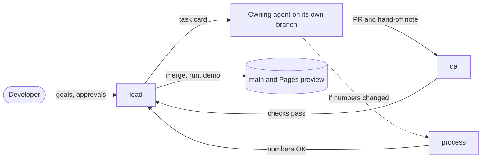

[Index](../README.md) · Agent plan · [Roadmap](../09-development-roadmap.md)

# Agent development plan

Build the simulation with seven agents. Each one owns one part of the code, and they work in parallel through the six phases and three gates of the [roadmap](../09-development-roadmap.md). A lead agent hands out tasks and merges the work. The developer approves decisions and signs off each gate.

## Phases

| Phase | Weeks | Critical path | Ends with | Detail |
|---|---|---|---|---|
| 1. Setup | 1 | lead, process | Project runs; `plant.json` settled | [Phase 1](phase-1-setup.md) |
| 2. Grey-box plant | 2–3 | scene | **G1** · grey-box plant | [Phase 2](phase-2-grey-box.md) |
| 3. Liquid line (1–6) | 4–6 | sim | Stages 1–6 live; model tests pass | [Phase 3](phase-3-liquid-line.md) |
| 4. Packs to trucks (7–10) | 7–9 | sim | **G2** · scope freeze | [Phase 4](phase-4-packs-to-trucks.md) |
| 5. Detail & scenarios | 10–11 | assets, sim | Hero models, six faults, guided tour | [Phase 5](phase-5-detail-and-scenarios.md) |
| 6. Polish & present | 12 | qa, lead | **G3** · final demo | [Phase 6](phase-6-polish-and-present.md) |
| 9. Factory board | after the term | lead, factory-* agents | The real factory's lines live from Let Report | [Phase 9](phase-9-factory-board.md) |
| 10. Factory floor in 3D | after the term | lead, factory-* agents | The three UHT trains in 3D, moving with the board | [Phase 10](phase-10-factory-floor.md) |
| 11. Plant type & phone | three waves | lead (wave 0), then six lanes at once | A direct or indirect UHT plant, and a phone layout (planned) | [Phase 11](phase-11-plant-type-and-phone.md) |

## The agents

| Agent | Role | Writes (owns) | Has the final say on |
|---|---|---|---|
| `lead` | Orchestrator and integrator: plans each week, writes task cards, merges, runs gates | `src/main.ts`, `src/contracts/`, `package.json`, `vite.config.ts`, CI, `plan/` | Scope, contracts, merge order |
| `process` | Process engineer: turns the stage research into numbers, expected results and on-screen text | `src/data/` (`plant.json`, `stages.json`, captions), `plan/06-simulation-model.md` | Every number and every process behaviour |
| `sim` | Simulation core: clock, event queue, continuous and discrete models, scenarios. Never imports three.js | `src/sim/` | How the model computes |
| `scene` | 3D view: world, equipment classes, pipes, tokens, camera, picking | `src/scene/` | How the plant looks and moves |
| `assets` | 3D assets: CC0 kits, carton/tray/pallet meshes, the four hero models | `public/models/`, `public/textures/`, `assets/` (source files, scripts, licences) | Model budgets and node names |
| `ui` | Screen: top bar, stage rail, info panel, KPI strip, charts, tour, scenario menu | `src/ui/`, `index.html`, `src/styles/` | Layout and controls |
| `qa` | Tests and performance: Vitest, browser smoke tests, fps checks, reviews every merge | `tests/`, `e2e/`, `tests/perf/` | Whether a merge is ready (can block it) |

**The developer** is the product owner. They approve each entry in the decision log, sign G1, G2 and G3, do any hand modelling in Blender the `assets` agent can't script, record the demo video and give the presentation.

## Who does what, phase by phase

Bold marks the agents on the critical path in that phase.

| Agent | 1 Setup | 2 Grey-box | 3 Liquid line | 4 Packs to trucks | 5 Detail & scenarios | 6 Polish & present |
|---|---|---|---|---|---|---|
| `lead` | **Scaffold, CI, contracts v0** | Frame loop, contracts v1, G1 | Contracts v2, weekly demos | Contracts v3 frozen, G2 cut list | Guard the freeze | **Release, report, G3** |
| `process` | **Settle R1–R4 and R7; write `plant.json`** | `stages.json`, layout review | Acceptance runs, "About this model" | Logistics checks, captions 7–10 | Scenario scripts, tour captions | Final number check, demo script |
| `sim` | Clock, event queue, RNG, mock snapshot | Static plant from set points | **Stages 1–6** | **Stages 7–10** | **Six fault scenarios** | Bug fixes only |
| `scene` | World, renderer, camera | **Zones, grey boxes, pipes, fly-to** | Liquid-line animation | Tokens, quarantine, racks, trucks | Hero swap, tour camera | Performance, polish |
| `assets` | Pipeline, kit check | Kit, tokens, hero specs | Hero block-outs | First-pass hero GLBs | **Finish hero models** | Optimise only |
| `ui` | App shell | Bar, rail, panel, KPI strip | Panels 1–6, sliders, charts | Panels 7–10, batch list | Scenario menu, tour, About panel | Polish |
| `qa` | Test harness, clock, queue and formula tests | Smoke tests, perf baseline | Formula, balance and soak tests | Conservation tests, silo-to-truck run | Scenario tests | **60 fps check, regression** |

## How the agents work together

### Contracts

The plan's architecture already keeps the sim free of 3D code and has the view and UI read one snapshot per frame. The contracts in `src/contracts/` make that boundary the only thing agents share:

```ts
// src/contracts/ (sketch of v0; fields are added phase by phase)
export interface Snapshot {
  version: number;                 // CONTRACT_VERSION
  timeS: number;                   // sim seconds since start
  speed: Speed; paused: boolean;
  stages: Record<StageId, { status: 'ok' | 'warn' | 'bad' | 'idle'; values: Record<string, number> }>;
  liquid?: LiquidSnapshot;         // phase 3
  packs?: PacksSnapshot;           // phase 4
  kpis: Kpis;
  log: LogEntry[];
}
export type Command =              // UI → sim, the only way in
  | { type: 'setSpeed'; speed: Speed }
  | { type: 'pause'; paused: boolean }
  | { type: 'nextEvent' }
  | { type: 'setSetpoint'; key: SetpointKey; value: number }
  | { type: 'triggerScenario'; id: ScenarioId }
  | { type: 'setQaResult'; batchId: number; result: 'pass' | 'fail' };
export type ViewEvent =            // UI ↔ scene, never reaches the sim
  | { type: 'selectStage'; stage: StageId }
  | { type: 'selectBatch'; batchId: number }
  | { type: 'tour'; on: boolean };
```

- `PlantConfig` types `plant.json`. `units.ts` holds the unit rule from [R8](../REVIEW.md#r8-units-in-typescript) (shown here with unit suffixes such as `timeS`).
- Versions: v0 in week 1, v1 at G1, v2 at week 6, v3 at G2. After G2, changes may only add fields.
- `sim` keeps a mock snapshot generator and `qa` keeps recorded snapshot fixtures (divert, filler down, quarantine full). That way `scene` and `ui` can build a state's visuals before the model can produce it.

### Ownership rules

1. An agent writes only in the folders it owns. If it needs a change elsewhere, it asks for it in a task for the owner.
2. Contract changes go through `lead`. Adding a field just bumps the version; renaming or removing one is only allowed before G2.
3. Only `process` changes numbers, in `plant.json` and the [default settings](../06-simulation-model.md#default-settings) table together. Each number gives a source or says "sim assumption".
4. `qa` can block a merge. No one edits an expected value in a formula test except `process`, with a source.
5. Nothing under `src/sim/` imports `three`. A lint rule enforces this in CI.

### The task loop



Every task card uses the same template:

```text
Task:        <one line>                 Agent: <id>   Phase: <n>   Week: <n>
Why:         <deliverable or review note it serves>
Inputs:      contracts v<n>; plant.json keys …; fixtures …
May change:  <paths inside the agent's folders>
Done when:   <tests or visible behaviour>; npm run check passes
Depends on:  <other task cards>
```

Every pull request ends with a hand-off note:

```text
Changed:     <what, in one or two lines>
Contract:    fields added or read (version)
See it:      <command, speed, stage to click>
For others:  <follow-up tasks this creates, by agent>
```

### Weekly rhythm

- **Monday:** `lead` writes the week's task cards from the phase page, one lane per agent, and posts any contract change first.
- **Tuesday to Thursday:** agents work in parallel on their own branches. `lead` merges as soon as the checks pass, in dependency order: contracts, then `sim`, then `scene` and `ui`, then tests.
- **Wednesday:** integration run. `lead` runs the merged build at every speed preset and files what breaks.
- **Friday:** demo build to the Pages preview, deliverables ticked in the [roadmap](../09-development-roadmap.md), next week's risks noted. At a gate, the developer walks through the gate checklist.

### Working together faster

Phases 2–10 showed where parallel lanes lose time. The lanes rarely clashed in the code. They lost time waiting for each other, rerunning the same slow checks, and starting again after an interruption. From phase 11 on, lanes work like this ([D22](../DECISIONS.md#d22-faster-lanes-waves-the-lane-kit-and-test-tiers)).

**Waves, not weeks.** A phase runs in three waves:

| Wave | Who | What it delivers |
|---|---|---|
| 0 | `lead` alone, in one sitting | The contracts and new `plant.json` keys (with placeholder values), the `?mock` sim answering for the new fields, new files' lanes in `scripts/lanes.json`, one task card per lane |
| 1 | Every other lane, all at once | Each lane's work, built against the contracts, the mock and the recorded snapshots in `tests/fixtures/`, never against another lane's work in progress |
| 2 | `qa`, then `lead` | Fixtures from the merged model, tests for the H rows, mutants; the merge train and one full run of every check |

In phase 3, the mock lacked the new values until `sim` merged. The panels showed "—" behind a list of keys still awaited, and `scene` tested on snapshots it built by hand. Wave 0 puts the new fields in the mock first, so no lane in wave 1 waits on another. Keys come before values: code and tests read `plant.json` by key, so `process` can settle a number in wave 1 without breaking anyone.

**The lane kit.** Run `npm run lane -- <command> <lane>`. The lane map, `scripts/lanes.json`, is the source of truth for who owns what, each lane's port, and its tests.

| Command | What it does |
|---|---|
| `start <lane> <task>` | A worktree on branch `agent/<lane>/<task>`, with `node_modules` linked |
| `setup <lane>` | The same inside a worktree the Agent tool made; prints the lane card |
| `check <lane> [--e2e]` | The lane tier: owned paths, typecheck, lint of what changed, the lane's unit tests and those its change reaches; with `--e2e`, its browser specs |
| `e2e <lane>` | The lane's browser specs on its own port, against a production build |
| `owns <lane>` | Fails if the lane changed a path it does not own; the lead runs it before each merge |
| `handoff <lane>` | The hand-off note, with what the diff can tell filled in: files, contract version, new `plant.json` keys, files for another owner |
| `ports` | The port table (a reviewer of a lane uses its port + 5) |

**Two test tiers.** The full browser suite takes about 25 minutes on software WebGL, so it runs once per merge, not once per lane.

| Tier | Who runs it | What it runs | Time |
|---|---|---|---|
| Lane | Each lane, as often as it likes | `npm run lane -- check <lane> --e2e` | Minutes |
| Merge | `qa` or `lead`, once on the merged head | `npm run check`, `npm run build`, `E2E_SERVER=preview npm run e2e` | About half an hour |

**Rules learned the hard way:**
- **Commit work in progress.** Commit `WIP <lane>: …` before any long run. After a usage limit, the lead resumes the same agent with a message instead of starting a new one, so its context and commits carry on. The lead squashes WIP commits at the merge.
- **Stop only your own servers.** Stop a server by its PID, never with `pkill -f`: that pattern also matched the shell running it, and other lanes' runs.
- **Test against a production build.** Browser runs during a merge use `E2E_SERVER=preview`. A dev server reloads the page when a merge writes a file, and fails tests that would pass.
- **Keep your scratch files apart.** A lane keeps its scratch files in a folder named after itself, because lanes overwrote each other's logs in a shared scratchpad.
- **Merge in contract order.** The merge train goes contracts → `sim` → `scene` and `ui` → tests, squashing each lane after `npm run lane -- owns <lane>` passes. Then one merge tier runs for the whole train.

### Definition of done

- A lane: `npm run lane -- check <lane> --e2e` passes, and the hand-off note from `npm run lane -- handoff <lane>` is filled in.
- A merge: `npm run check` passes (typecheck, lint, Vitest, the asset-script and lane-kit tests), and so does the full browser suite on the merged head.
- No `three` import under `src/sim/`, and units converted only in `units.ts`.
- Any new snapshot fields appear in the hand-off note.
- Any changed numbers have been reviewed by `process`.
- 60 fps still holds on the grey-box scene, then on the full scene from phase 4 on.

## Review notes by phase

Each open point in the [plan review](../REVIEW.md) is assigned to the phase that closes it.

| Note | Closed in | By |
|---|---|---|
| [R1](../REVIEW.md#r1-batch-size) batch size, [R2](../REVIEW.md#r2-missing-defaults) missing defaults, [R3](../REVIEW.md#r3-truck-payload) truck payload | Phase 1 | `process` decides, the developer approves |
| [R4](../REVIEW.md#r4-divert-rule) divert rule, [R7](../REVIEW.md#r7-homogenizer-outlet) homogenizer outlet | Phase 1 (numbers), phase 3 (model) | `process`, then `sim` |
| [R8](../REVIEW.md#r8-units-in-typescript) units, [R11](../REVIEW.md#r11-versions-and-hosting) versions and hosting | Phase 1 | `lead` |
| [R5](../REVIEW.md#r5-plant-type-mix) plant-type mix, [R6](../REVIEW.md#r6-holding-time) holding time | Phase 3 | `process` (About text), `sim` (hold from live flow) |
| [R9](../REVIEW.md#r9-quarantine-scale) quarantine scale | Phase 4 | `scene`, `ui` |
| [R10](../REVIEW.md#r10-rare-qa-failures) rare QA failures | Phase 5 | `sim` (manual trigger, filter link) |

## Running the agents

With Claude Code, each agent is a subagent defined in `.claude/agents/<id>.md`: `process`, `sim`, `scene`, `assets`, `ui`, `qa` and the four `factory-*` agents. Each definition gives the agent's row in the agents table, the ownership rules and the lane rules above. `lead` is the main session the developer talks to. It starts each subagent with one task card on its own branch (`agent/<id>/<task>`, or the branch the Agent tool's worktree has) in its own git worktree, so lanes don't overwrite each other. The subagent starts with `npm run lane -- setup <id>`. GitHub milestones (one per phase) and labels (one per agent) hold the task cards, and `plan/DECISIONS.md` logs every decision the developer approves.

---

← [9. Development roadmap](../09-development-roadmap.md) · [Phase 1. Setup](phase-1-setup.md) →
