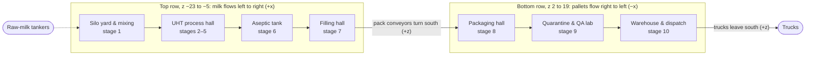

[Agent plan](README.md) · [Phase 2](phase-2-grey-box.md) · G1 checklist

# G1 checklist · the grey-box plant against the floor plan

What the G1 review checks in the merged plant, zone by zone: every Must item of the [3D asset list](../05-layout-and-3d-assets.md#3d-asset-list) (and the Should items), where it stands in the [preview](../../uht-plant-preview.html), and which way the product must flow through the U of the [floor plan](../05-layout-and-3d-assets.md#zones-as-text). Written by `process` for the [gate G1 checklist](phase-2-grey-box.md#gate-g1-checklist); the result of the first run is in [Layout review](#layout-review) at the end.

## How to read and run it

- **Coordinates** are the preview's, in metres (1 three.js unit = 1 m): x runs along the milk flow from the silos (−x) to the fillers (+x), y is up, and z runs from the milk row (−z) to the pallet row and the truck docks (+z). Positions are centres unless marked; sizes are x × y × z. In the app, `src/scene/layout.ts` holds the zones and camera stops, each machine in `src/scene/equipment/` stands at its preview position, `src/scene/equipment/packs/layout.ts` holds the stage 7–10 positions and paths, and `src/scene/pipes.ts` the pipe routes.
- **Priority** is the asset list's. G1 needs every Must item as a grey box. Should items are checked if they are built, with one exception: stage 10 has no Must item, so at least its racks are needed for a 3D click to select it.
- **At G1** says what is enough now. Hero machines stay grey boxes until phase 5, but their moving parts already carry the node names the [phase 2 plan](phase-2-grey-box.md#who-does-what) and [assets/README.md](../../assets/README.md) give (`bowl`, `piston_1` to `piston_3`, `reel`, `jaws`, `arm_*`), so the swap needs no code change. Moving tokens (cartons, trays, pallets) are phase 4; static ones are enough now.
- **Running the review:** `npm run dev -- --port <port> --strictPort`, open `/?debug` in Chromium (here: `--enable-unsafe-swiftshader`, 1440 × 900). For each stage, click its rail button and check that the camera lands on the items below and the panel shows the stage's text; then go back to the whole-plant view with **Whole plant** above the rail (or Esc) and click one of its machines in 3D at `window.__scene.stageScreenPoint(n)`, and check that the rail and panel follow. `window.__scene.equipmentIds()` lists every machine.

## The U and its flow direction

- [x] **Top row (milk):** the liquid line runs left to right along z = −14, from the silos at x −59 to the aseptic tank at x 4 and on to the fillers at x 20.
- [x] **East turn:** the two pack conveyors leave the fillers eastward, turn south at x 34 and x 32, and cross the aisle between the rows (z −5 to 2) into the packaging hall.
- [x] **Bottom row (pallets):** trays and pallets run right to left (−x), from the palletizer at x 28 through quarantine (x −11 to 11) into the warehouse (x −63 to −14).
- [x] **Out:** trucks dock at the warehouse's south wall (z 19) and leave south across the apron (x −63 to −14, z 19 to 38; the preview's apron ends at z 33, but our 16.5 m truck reaches z 36.1). Raw-milk tankers arrive at the silo yard (zone text only; no asset row, so not needed at G1).
- [x] **Zones:** all seven floor areas are tinted and labelled with their name and stage numbers just outside their near (+z) edge, so the machines and their lamps never cover a name in the whole-plant view; the preview put them at the north-west corner (`ZONES` in `src/scene/layout.ts`, `zoneLabelPlacement` in `src/scene/zones.ts`).

## 1 · Silo yard & mixing (stage 1)

Zone x −63 to −38, z −23 to −5. **Flow:** raw milk leaves the two silos on the west edge, runs east along z = −14 through the separator and the standardization skid into the mixing tank, then on into the process hall.

| Item | Priority | Where in the preview (m) | At G1 |
|---|---|---|---|
| Raw-milk silos (2) | Must | (−59, −18.5) and (−59, −9.5); radius 2.2, body y 0.6 to 10.6, dome to 11.4; plinth ring radius 2.45; ladder on the east side (x −56.75) | Grey boxes `silo-a`, `silo-b` |
| Separator | Must, hero | Frame (−51.5, 0.4, −14), 1.7 × 0.8 × 1.7; bowl centre (−51.5, 1.35, −14), radius 0.6; motor (−51.5, 0.4, −15.55) | Grey box with a spinning `bowl` node: `separator` |
| Mixing tank with agitator | Must | (−42.4, −14); radius 1.5, body y 0.75 to 4.15 on 4 legs, dome; agitator drive and blade at y 4.8 to 5.15 | Grey box with an `agitator`: `mixing-tank`. It is the UHT feed tank of the chart values |
| Standardization skid | Should | Deck (−47.6, 0.55, −14), 2.8 × 0.1 × 1.3; three flow meters at x −48.5, −47.6, −46.7, z −13.55 | `standardization-skid` |

## 2 · UHT process hall (stages 2–5)

Zone x −35 to −6, z −23 to −5. **Flow:** east along z = −14 from the balance tank to the flash vessel; the product then drops to the tubular cooler at z −11.6 and runs east out of the hall toward the aseptic tank. The divert branch leaves the valve south (+z) to the reject tank.

| Item | Stage | Priority | Where in the preview (m) | At G1 |
|---|---|---|---|---|
| Balance tank, feed pump | 2 | Should | Tank (−33, −14), radius 0.55, body y 0.3 to 1.7; pump (−31.9, 0.25, −13.1) | `balance-tank` |
| Plate heat exchanger | 2 | Must | Frame and pressure plates at x −30.2 and −27.6; 18 plates from x −29.95 at 0.122 pitch, each 0.055 × 1.75 × 0.95, centred y 1.1, z −14; carrying bars at y 2.25 | One `InstancedMesh` for the plates: `plate-heat-exchanger` |
| Deaerator with condenser | 2 | Must | (−24.8, −14); radius 0.7, body y 0.95 to 3.45 with a cone below and a dome above, on 3 legs; condenser on top (radius 0.28, y 3.75 to 4.45); vacuum pump (−23.5, 0.23, −12.8) | `deaerator` |
| Homogenizer | 3 | Must, hero | Crankcase (−20.5, 0.75, −14), 2.2 × 1.1 × 1.3, on a 2.5 × 0.2 × 1.5 base; pistons at x −21.1, −20.5, −19.9, z −13.1; motor (−20.5, 0.55, −15.35); two gauges at x −21.0 and −20.1 | Pistons named `piston_1` to `piston_3`: `homogenizer` |
| Steam injector | 4 | Must | (−17, 1.0, −14), radius 0.18, 0.75 tall | `steam-injector` |
| Holding tube | 4 | Must | Coil of 5.5 turns, radius 0.6, around (−14.8, −14), rising from y 0.9 to 2.5, tube radius 0.085; supports at x −15.55 and −14.05 | The coil is a `TubeGeometry` at 140 °C, pickable as stage 4; supports: `holding-tube` |
| Flow-diversion valve | 4 | Must | Body (−12.6, 2.5, −14), 0.45 cube; green/red light on top at y 2.92 | `divert-valve`. The light can wait for phase 3 ("valve flips, red light") if the valve shows its state another way |
| Reject tank | 4 | Must | (−12.6, −10.5), radius 0.75, 1.6 tall, see-through | `reject-tank` |
| Flash vessel | 5 | Must | (−10, −14); radius 0.85, body y 1.0 to 4.0 with a cone below and a dome above, on 3 legs; vapour condenser lying along x at (−8.25, 4.9, −14), radius 0.3, 1.3 long | `flash-vessel` |
| Tubular cooler | 5 | Must | Return headers at x −9.45 and −5.95 (y 0.8, z −11.6); three passes as pipes at y 0.5, 0.8 and 1.1 between x −9.3 and −6.1 | Headers: `tubular-cooler`; the passes are pipes |
| Boiler house | 4 | Could | (−17, 1.2, −21.3), 3.2 × 2.4 × 2.2, stack at (−16, −21.7); steam pipe to the injector | Optional. The CIP station (Could) is not in the preview |

## 3 · Aseptic tank (stage 6)

Zone x −3 to 11, z −23 to −5. **Flow:** cool milk arrives from the west (the cooler line runs east at z −11.6 to x 1, then north to the tank); two lines leave east at floor level toward the fillers.

| Item | Priority | Where in the preview (m) | At G1 |
|---|---|---|---|
| Aseptic tank | Must | (4, −14); radius 1.8, body y 1.05 to 5.55, see-through so the level shows, on 3 legs 1.0 tall at radius 1.35; dome; sterile-air filter (5.3, 6.15, −14); status lamp (4, 6.25, −14) | `aseptic-tank`, milk level at 50% from the static snapshot |

## 4 · Filling hall (stage 7)

Zone x 14 to 37, z −23 to −5. **Flow:** milk arrives from the west at both fillers; packs leave each filler east on its outfeed conveyor.

| Item | Priority | Where in the preview (m) | At G1 |
|---|---|---|---|
| Aseptic fillers (2) | Must, hero | Filler A cabinet (20, 1.2, −17.5), filler B (20, 1.2, −10.5), each 3.2 × 2.4 × 2.2; glass aseptic zone on top (2.0 × 1.1 × 1.6, centre y 2.95) with the product tube at x 19.7; paper reel radius 0.78 at (19.2, 1.0, −18.92) for A and (19.2, 1.0, −9.08) for B; lamps at (21.3, 3.75) | Grey boxes with `reel` and `jaws` nodes |
| Pack conveyors (outfeed) | Must | Filler A: (21.75, −17.5) east to (34, −17.5), then south to (34, 4.9). Filler B: (21.75, −10.5) east to (32, −10.5), then south to (32, 4.9). Belt top y 0.86, 0.62 wide | Grey boxes or Kenney Factory Kit pieces ([D12](../DECISIONS.md#d12-conveyor-models)). The preview tags these belts stage 7 |
| Accumulation table | Must | Not in the preview. Anywhere on the two pack lines between the fillers and the tray-shrink tunnel | Grey box or kit pieces, stage 7 or 8 |
| 1 L carton | Must | On the outfeed belts: the preview spaces them 0.58 m apart along each line | Static cartons on the belts; movement is phase 4 |

## 5 · Packaging hall (stage 8)

Zone x 14 to 37, z 2 to 19. **Flow:** packs enter from the north on the two conveyors, pass the tray-shrink tunnel southward, then trays run west to the palletizer; finished pallets leave west toward quarantine along z 14.4.

| Item | Priority | Where in the preview (m) | At G1 |
|---|---|---|---|
| Tray conveyor | Must | (33, 8.4) south to (33, 11.2), then west to (29.85, 11.2); belt top y 0.86 | Grey box or kit pieces, stage 8 |
| Tray-shrink tunnel | Should | (33, 0.95, 6.65), 3.6 × 1.7 × 3.3 (z 5.0 to 8.3); curtains at z 4.98 and 8.32. The preview's tunnel also stands in for the tray packer | Grey box, stage 8 |
| Palletizer robot | Should, hero | Base (28.3, 0.3, 13.2), radius 0.55; column to y 2.35; arm 2.45 long; picks at the tray-line end (29.85, 11.2) and places on the pallet at (26.2, 14.4) | Grey box with `arm_*` nodes |
| Tray, pallet | Must | Trays on the tray conveyor, 0.84 m apart in the preview; pallet (26.2, 0.08, 14.4), 1.5 × 0.16 × 1.15, with its load on top | Static trays on the tray conveyor and one pallet at the palletizer |
| Stretch wrapper | Could | Turntable (21.6, 14.4), radius 1.05; mast (20.15, 13.35), 2.7 tall | Optional |

## 6 · Quarantine & QA lab (stage 9)

Zone x −11 to 11, z 2 to 19. **Flow:** pallets enter from the east (the pallet path runs west along z 14.4 to the hall's edge, then to the batch's place); batches age from right to left, and released ones leave west at x about −15 into the warehouse.

| Item | Priority | Where in the preview (m) | At G1 |
|---|---|---|---|
| Quarantine zone | Must | Yellow hatched outline from (−10.9, 3.0) to (7.2, 17.6). Batch blocks 2.0 × 1.0 × 3.0 (height grows with the batch's pallets) on a grid: x = −9.6 + 2.55 × column, z = 4.6 + 3.8 × row (4 rows), each with a status lamp on top | Floor outline. One block and lamp per batch is phase 4 ([R9](../REVIEW.md#r9-quarantine-scale)); see the note on the grid in [Layout review](#layout-review) |
| QA lab with incubators | Must | Lab (9.4, 1.3, 5.6), 2.8 × 2.6 × 4.4, with a roof slab; three incubators at x 8.6, 9.4 and 10.2 (y 0.5, z 8.45), each 0.66 × 1.0 × 0.5 | Grey boxes, stage 9; these are the zone's pickable machines |

## 7 · Warehouse & dispatch (stage 10)

Zone x −63 to −14, z 2 to 19; apron x −63 to −14, z 19 to 38. **Flow:** released pallets arrive from the east, go into the racks, and leave south through the dock doors onto trucks.

| Item | Priority | Where in the preview (m) | At G1 |
|---|---|---|---|
| Racks | Should (needed: the zone's only pickable machine) | 4 rows at z 4.9, 8.7, 12.5 and 16.3; 16 bays of 2.5 from x −61 to −21; uprights 4.5 tall at z ±0.55 of each row; orange beams at y 1.55 and 3.15. Stock as blocks on 3 levels (y 0, 1.6, 3.2), one 2.2 × 1.25 × 1.02 block per bay and level, each standing for 10 pallets (192 blocks, 1,920 pallets) | Uprights and beams as `InstancedMesh`, stage 10. Stock in the racks is phase 4 |
| Loading docks | Should (with the trucks) | Three dock doors at x −54, −46 and −38, (y 1.9, z 19.15), 3.4 × 3.8 × 0.3 | Grey boxes, stage 10 |
| Trucks | Should | Trailer 2.5 × 2.7 × 9.6 and cab 2.4 × 2.5 × 2.2; docks with its rear at z 19.5 in front of a door, drives in and out along +z | CC0 model or grey box; driving is phase 4 |
| Forklifts | Should | Not in the preview. In the aisles between rack rows (z about 6.8, 10.6, 14.4) or at the docks | CC0 model or grey box; path following is phase 4 |

## Pipes (all zones)

Pipes are Must: `TubeGeometry` runs along the preview's routes, coloured from the [line points](../hand-calculations.md#line-points) (H64–H75), blue at 4 °C through yellow to red at 140 °C ([colour rules](../08-user-interface.md#colour-rules)). Take the routes from the preview, but not its temperatures past the homogenizer: the preview still has the old 76 °C outlet, which [D5](../DECISIONS.md#d5-homogenizer-outlet) changed to 81.75 °C.

| Run (preview name) | From → to | Temperature along it |
|---|---|---|
| Silo manifold, start of `PRE` | Both silos (x −56.85, z −18.5 and −9.5) → separator | `silo` 4 °C, warmed to `separator` 60 °C before the separator |
| `PRE`, stage 1 | Separator → skid → mixing tank | `separator` 60 °C, cooled to `feedTank` 4 °C before the tank |
| `PRE`, stage 2 | Mixing tank → balance tank → plate heat exchanger | `feedTank` 4 °C, up to `preheater` 80 °C across the plates |
| `PRE`, stages 2–3 | Heat exchanger → deaerator → homogenizer | `preheater` 80 °C, then `deaerator` 76 °C |
| `PRE`, stages 3–4 | Homogenizer → steam injector | `homogenizer` 81.75 °C, then 140 °C from the injector on |
| `HELIX` | Holding tube → divert valve (−12.6, 2.5, −14) | `holdingTube` 140 °C |
| `PROD` | Valve → flash vessel → three cooler passes → (1.0, −11.6) → aseptic tank (4, −14) | 140 °C into the vessel, `flashVessel` 80 °C out, down the passes to `cooler` 20 °C, then 20 °C to the tank |
| `DIV` | Valve → south to (−12.6, −10.5) → down into the reject tank | `divert`: 140 °C, the holding-tube outlet. It carries milk only during a divert, so its stripes stand still in the static plant |
| `OUT_A`, `OUT_B` | Tank bottom (4, 0.55, −14) → east to x 13 → split to z −17.5 and −10.5 → fillers at (19.7, 2.5) | `asepticTank` 20 °C |
| Utility pipes | Steam (boiler house → injector), vapour (flash vessel → condenser), vacuum (deaerator → vacuum pump), sterile air (aseptic tank) | Plain metal, not temperature-coloured |

## Camera stops

Each rail button and each 3D click must fly the camera to the stage's stop (`STAGE_VIEWS` in `src/scene/layout.ts`, the preview's `FOCUS` and `CAMOFF`) with that stage's machines in view.

| Stage | Zone | Looks at (x, y, z) | Must be in view |
|---|---|---|---|
| 1 | Silo yard & mixing | (−50, 1.5, −14) | Silos, separator, skid, mixing tank |
| 2 | UHT process hall | (−28, 1.5, −14) | Balance tank, plate heat exchanger, deaerator |
| 3 | UHT process hall | (−20.5, 1, −14) | Homogenizer |
| 4 | UHT process hall | (−15, 1.4, −13) | Steam injector, holding tube, divert valve, reject tank |
| 5 | UHT process hall | (−9, 1.8, −13) | Flash vessel, condenser, tubular cooler |
| 6 | Aseptic tank | (4, 3, −14) | Aseptic tank |
| 7 | Filling hall | (23, 1.4, −14) | Both fillers and their outfeeds |
| 8 | Packaging hall | (28, 1, 10.5) | Tunnel, tray conveyor, palletizer, pallet |
| 9 | Quarantine & QA lab | (−1.5, 1, 10.3) | Quarantine area and QA lab |
| 10 | Warehouse & dispatch | (−39, 1.5, 11.5) | Racks and dock doors |

## Layout review

The merged plant at commit `5673218` (scene-core, scene-packs and ui merged), run as above on 2026-10-13 by `process`. **Result: the U, the flow directions, the zones and the camera stops match the floor plan, and every Must item stands except the 1 L carton and the tray tokens.** Defects are listed at the end with the lane that owns the fix. **Update, merge `c4af915`:** the G1 defects 1, 2, 3, 7 and 9 are fixed (rows below); the rest belong to phases 3–5.

### Zones, flow and selection

| Check | Result |
|---|---|
| Zone order of the U | Yes. Top row west to east: Silo yard & mixing (1), UHT process hall (2–5), Aseptic tank (6), Filling hall (7); bottom row east to west: Packaging hall (8), Quarantine & QA lab (9), Warehouse & dispatch (10); apron south of the warehouse. Rectangles as in the preview |
| Milk flow, top row | Yes. Pipes run east along z −14 from the silo manifold to the aseptic tank, then on to both fillers. Colours follow the line points: blue from the silos, yellow-orange at the separator (60 °C), blue again into the mixing tank, warming across the plates to orange (80 °C), 76 °C, 82 °C, red from the injector through the coil, orange out of the flash vessel, teal (20 °C) after the cooler passes |
| Packs and pallets | Yes. Both outfeeds leave the fillers east, turn south at x 34 and 32, cross the accumulation table and the aisle into the tunnel; trays run south then west to the palletizer; pallet rollers run west through the stretch wrapper to the hall's edge at x 14.4 |
| Dispatch | Yes. Three dock doors on the warehouse's south wall; the truck stands at the middle door and points south across the apron |
| Equipment ids | 33: `silo-a`, `silo-b`, `separator`, `standardization-skid`, `mixing-tank`, `balance-tank`, `plate-heat-exchanger`, `deaerator`, `homogenizer`, `steam-injector`, `holding-tube`, `divert-valve`, `reject-tank`, `flash-vessel`, `tubular-cooler`, `aseptic-tank`, `filler-a`, `filler-b`, `pack-conveyors`, `accumulation-table`, `tray-shrink-tunnel`, `tray-conveyor`, `palletizer`, `stretch-wrapper`, `pallet-conveyor`, `quarantine`, `qa-lab`, `racks`, `docks`, `forklift-1`, `forklift-2`, `truck`, `boiler-house` |
| Rail click, stages 1–10 | Yes. Each lands (`data-focus-stage`), marks its rail button (`aria-current`) and shows the stage's text; every stop shows the items in [Camera stops](#camera-stops). The stage 1 stop shows the silos cut off at the frame's edge, as in the preview |
| 3D click from the whole-plant view, stages 1–10 | Yes. A click at `stageScreenPoint(n)` selects stage n, the camera lands and the panel follows |
| Console | No errors or warnings, no failed requests |
| Draw calls at the whole-plant view | 176 calls and 75,994 triangles in the first frames, then 175 calls and 97,842 triangles once the Kenney pieces replace the grey-box conveyors (about 1 s). Under SwiftShader, the only GL here, 3–5 fps while other work shared the machine, so the 60 fps check needs a GPU |

### Items

| Item | Priority | Equipment id | Present | Note |
|---|---|---|---|---|
| Raw-milk silos (2) | Must | `silo-a`, `silo-b` | Yes | At the preview's positions; labels show the silo temperature |
| Separator | Must, hero | `separator` | Yes | `bowl` node spins while the line flows |
| Mixing tank with agitator | Must | `mixing-tank` | Yes | Agitator turns |
| Standardization skid | Should | `standardization-skid` | Yes | |
| Balance tank, pumps | Should | `balance-tank` | Yes | With the feed pump |
| Plate heat exchanger | Must | `plate-heat-exchanger` | Yes | 18 plates in one `InstancedMesh` |
| Deaerator with condenser | Must | `deaerator` | Yes | Condenser on top, vacuum pump beside it |
| Homogenizer | Must, hero | `homogenizer` | Yes | `piston_1` to `piston_3` stroke with the flow |
| Steam injector, holding tube | Must | `steam-injector`, `holding-tube` | Yes | The coil is the `pipe-holding-tube` mesh, pickable as stage 4 |
| Flow-diversion valve, reject tank | Must | `divert-valve`, `reject-tank` | Yes | No green/red light: a flag on the valve points down the open outlet and its label reads "forward" or "diverting". Plan 03 and the preview have the light; phase 3 adds it with the flip |
| Flash vessel, tubular cooler | Must | `flash-vessel`, `tubular-cooler` | Yes | Vapour condenser on the vessel; the cooler's three passes are pipes |
| Boiler house | Could | `boiler-house` | Yes | With the steam pipe to the injector. The CIP station (Could) is not built |
| Aseptic tank | Must | `aseptic-tank` | Yes | Three legs, sterile-air filter, milk level at 50% |
| Aseptic fillers (2) | Must, hero | `filler-a`, `filler-b` | Yes | `reel` and `jaws` nodes move while each filler runs |
| Conveyors, accumulation table | Must | `pack-conveyors`, `accumulation-table`, `tray-conveyor`, `pallet-conveyor` | Yes | Kit pieces ([D12](../DECISIONS.md#d12-conveyor-models)). The accumulation table stands on both pack lines at the south end of the filling hall (x 31.3 to 34.7, z −8.5 to −5.5), stage 7 |
| 1 L carton | Must | `pack-conveyors` (`cartons` InstancedMesh) | Yes (fixed) | 104 static cartons, 60 on line A from s 0 and 44 on line B from s 0.29, every 0.58 m, printed with `carton.png`; line B empties while filler B is stopped |
| Tray | Must | `tray-conveyor` (`trays` InstancedMesh) | Yes (fixed) | 8 static trays every 0.84 m on the tray line, printed with `tray.png` |
| Pallet | Must | `palletizer` (pallet with a part-built load), `racks` (stock from the KPI) | Yes | Printed with `pallet.png` |
| Tray-shrink tunnel | Should | `tray-shrink-tunnel` | Yes | Labelled "Tray packer & shrink tunnel" |
| Palletizer robot | Should, hero | `palletizer` | Yes | Its moving node is named `arm`, while the phase 2 plan and assets/README.md name the palletizer's nodes `arm_*` |
| Stretch wrapper | Could | `stretch-wrapper` | Yes | |
| Quarantine zone, QA lab | Must | `quarantine`, `qa-lab` | Yes | Amber outline at the preview's position with dashed lanes between the 4 rows of batch places; the lab has three incubators with lamps |
| Racks | Should | `racks` | Yes | 4 rows × 16 bays × 3 levels, two pallet places per bay and level: 384 places. The loads follow `kpis.palletsInStock` (empty on the static plant) |
| Loading docks | Should | `docks` | Yes | Three doors with bumpers and apron guide lines |
| Trucks | Should | `truck` | Yes | `vehicles/truck.glb` (own work, see assets/LICENSES.md), 16.5 m long at the middle door |
| Forklifts | Should | `forklift-1`, `forklift-2` | Yes | Grey boxes in the aisles at (−30, 10.6) and (−42.5, 17.95) |
| Pipes | Must | `pipe-*` meshes (not equipment) | Yes | Temperatures from `snapshot.line`, as in [Pipes](#pipes-all-zones); the homogenizer outlet run starts at 81.75 °C |

### Info panel

Every stage shows its `stages.json` name, the zone in the subtitle, the description, and one row per value with its scale, decimals and unit. As read in the panel with the static plant:

| Stage | Title | Rows |
|---|---|---|
| 1 | Standardization & Formulation | Raw-milk fat 4.00 %, Product fat 3.50 %, Cream in product 8.6 %, Raw-milk silo 4 °C, Separator 60 °C, Mixing tank (UHT feed) 4 °C |
| 2 | Preheating & Deaeration | Preheater outlet 80 °C, Deaerator 76 °C |
| 3 | Homogenization | First stage 200 bar, Second stage 30 bar, Inlet 76 °C, Outlet 82 °C |
| 4 | UHT Treatment | Holding-tube outlet 140.0 °C, Set point 140.0 °C, Divert limit 139.2 °C, B\* 1.19, F0 5.17 min, Holding time 4.0 s, Flow 16,000 L/h |
| 5 | Flash Cooling | Flash vessel 80 °C, Cooler outlet 20 °C |
| 6 | Aseptic Storage (Buffer) | Level 50 %, Contents 10,000 L, Capacity 20,000 L, Milk temperature 20 °C |
| 7 | Aseptic Packaging | Fillers 2, Rate per filler 7,500 packs/h, Milk temperature 20 °C |
| 8 | Secondary Packaging & Palletization | Packs per tray 12, Trays per pallet 84, Packs per pallet 1,008 |
| 9 | Quarantine & QA Testing | Incubation temperature 55 °C, Incubation time 7 days, Samples per batch 16 |
| 10 | Warehousing & Ambient Distribution | Storage temperature 25 °C, Pallets per truck 22 |

Each value matches its hand calculation (H1, H6, H7, H11–H13, H26, H29) or its `plant.json` key.

### Defects and follow-ups

| # | What | Owner | For |
|---|---|---|---|
| 1 | **Fixed** (scene-g1, `09520da`). ~~The 1 L carton and the tray, Must items, are missing.~~ Static tokens are enough at G1: cartons along both outfeeds (0.58 m apart in the preview) and trays on the tray conveyor (0.84 m apart), from the brand-free meshes the phase 2 plan asks of `assets` | `scene-packs`, with `assets` for the meshes | G1 |
| 2 | ~~No way back to the whole-plant view once a stage is selected~~ **Fixed:** the view bus has an `overview` event; **Whole plant** above the rail and Esc emit it, the rail and panel clear and the camera flies back (the preview's O key is left out) | `lead` (view event), `ui`, `scene-core` | G1 review comfort; the guided tour (phase 5) also needs it |
| 3 | **Fixed** (`09520da`): the rack loads follow the stock KPI. ~~The racks show a fixed sample of about 210 pallets while the KPI strip reads 0 pallets in stock. Show the racks empty until the snapshot carries stock, or take the count from `kpis.palletsInStock`~~ | `scene-packs` | G1 (low) |
| 4 | Rack scale: 384 pallet places cannot hold the stock. [D11](../DECISIONS.md#d11-opening-state) opens with 634 pallets and stock grows by about 33 a day ([H43](../hand-calculations.md#counts-and-rates)); the preview drew one block per 10 pallets (192 blocks, 1,920 pallets) | `scene-packs` | Phase 4 |
| 5 | Quarantine scale: the preview's grid (2.0 m blocks at 2.55 m, 4 rows from x −9.6) fits 7 columns, 28 blocks, inside the outline, but [D1](../DECISIONS.md#d1-batch-size) keeps up to 44 batches in the zone (42 on hold and 2 being filled, [H49](../hand-calculations.md#counts-and-rates)). Four rows of 11 blocks 1.2 m wide at a 1.6 m pitch fit the outline and keep the 4 marked lanes | `scene-packs` | Phase 4 ([R9](../REVIEW.md#r9-quarantine-scale)) |
| 6 | The flow-diversion valve has no green/red light (see Items) | `scene-core` (liquid line) | Phase 3 |
| 7 | **Fixed** (`09520da`): the apron runs to z 38. ~~The docked truck (16.5 m from its tail at z 19.6) reaches z 36.1, 3 m past the apron's south edge at z 33~~ | `scene-core` (apron) or `scene-packs` | Low |
| 8 | The palletizer's node is `arm`, not `arm_*`; agree the names with the palletizer's hero spec before phase 5 | `scene-packs`, `assets` | Phase 5 |
| 9 | **Fixed** (`09520da`): the names hang outside each zone's near edge, clear of machines and lamps. ~~Zone labels sit under the machines: in the whole-plant view silo B hides the start of "Silo yard & mixing", and the racks hide part of "Warehouse & dispatch"~~ | `scene-core` | Low |

---

← [Phase 2. Grey-box plant](phase-2-grey-box.md) · [Agent plan](README.md) →
